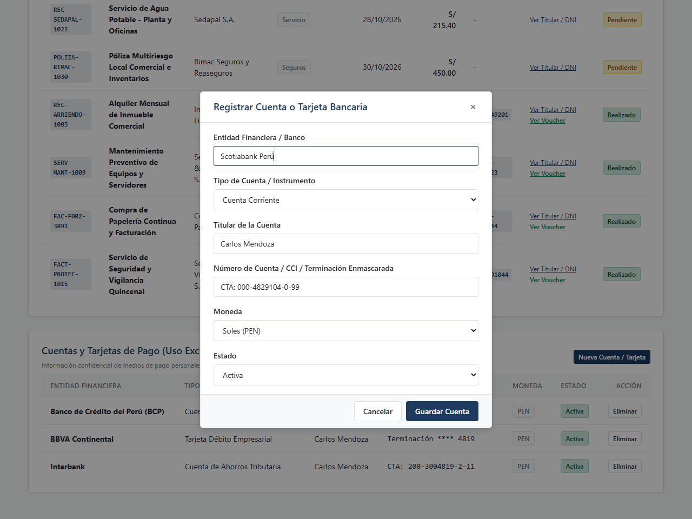
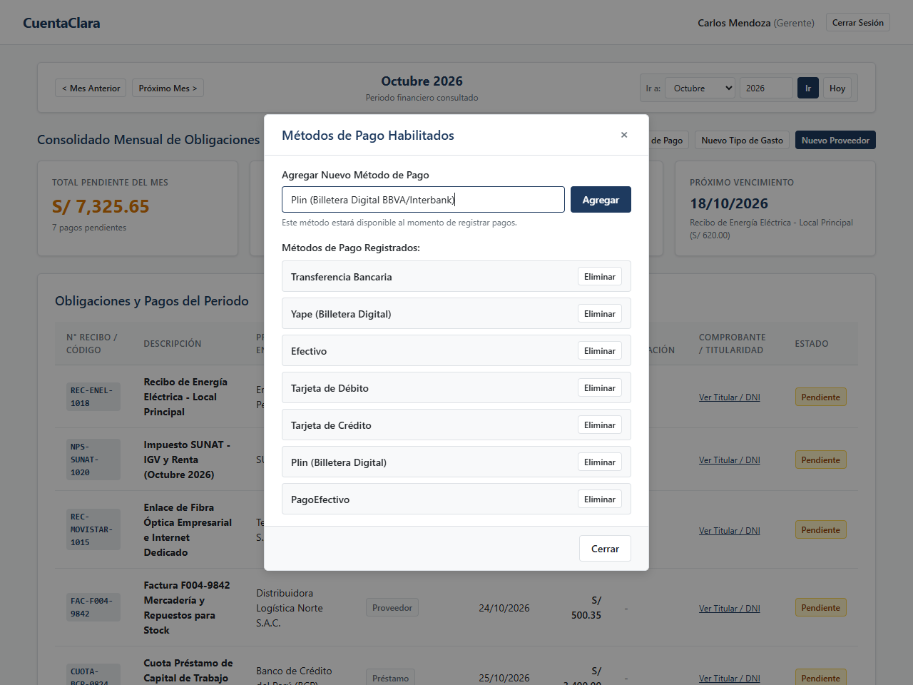
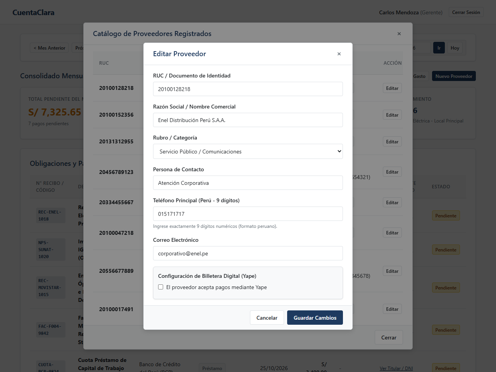
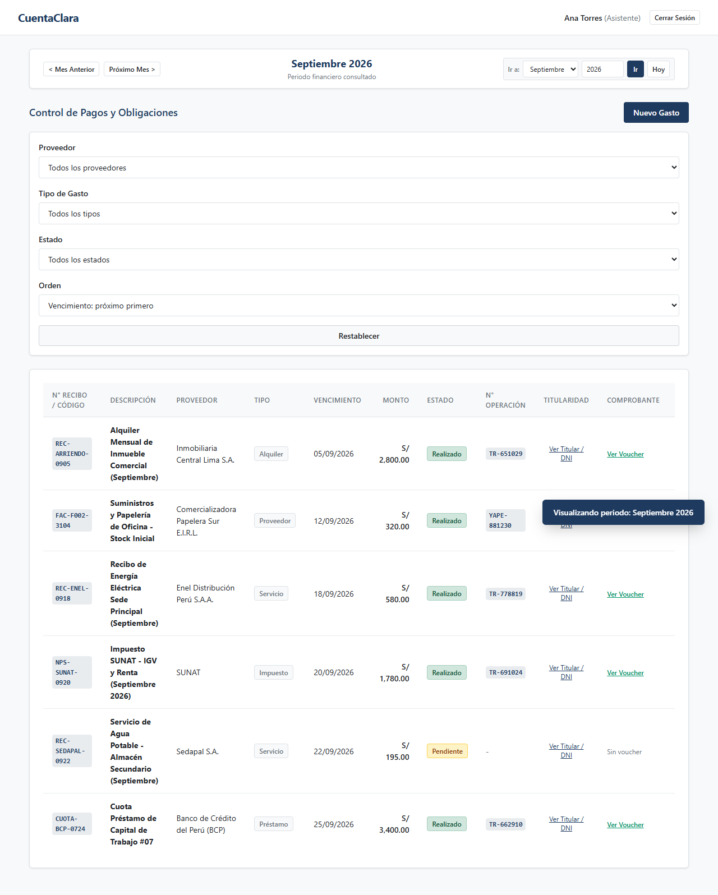
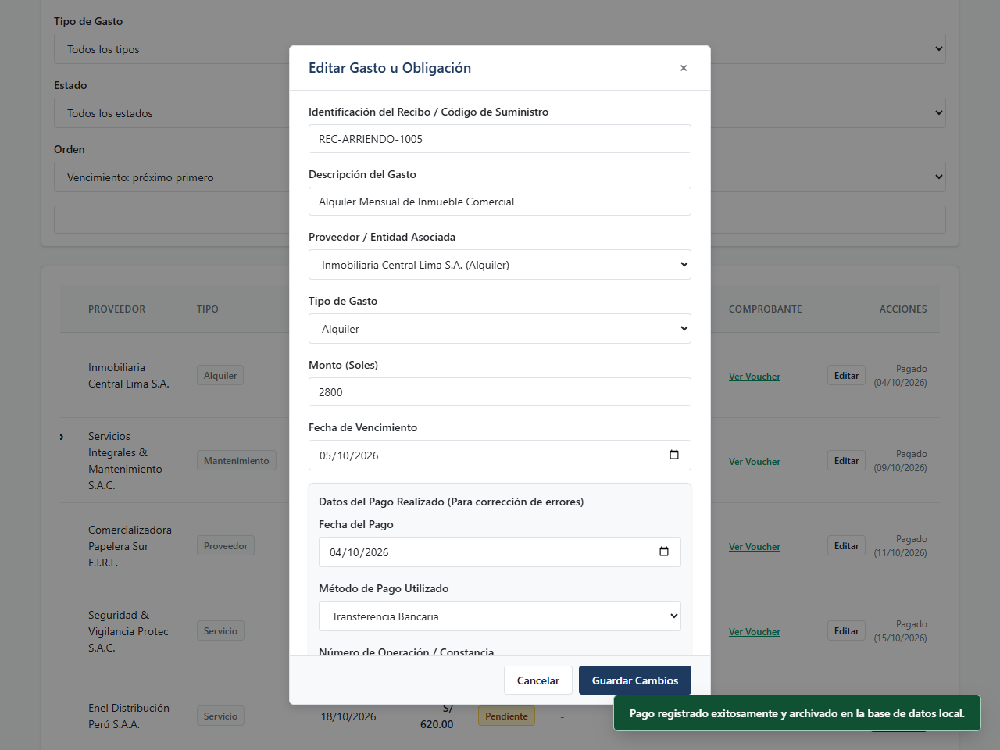

# CuentaClara - Expediente Técnico y Validación Integral del MVP
## Sistema de Gestión, Control y Registro de Obligaciones Financieras

- **Documento Word Listo para Presentación:** [docs/entregable_completo_mvp.docx](file:///d:/parcial-agile/docs/entregable_completo_mvp.docx) (o [docs/informe_evidencias_mvp.docx](file:///d:/parcial-agile/docs/informe_evidencias_mvp.docx))
- **Carpeta de Evidencias Gráficas:** [docs/evidencias/](file:///d:/parcial-agile/docs/evidencias/)
- **Documento de Especificación Inicial:** [docs/entregable_mvp.md](file:///d:/parcial-agile/docs/entregable_mvp.md)

---

## 1. Contexto del Negocio y Problemática Resuelta

El Gerente de la empresa administra múltiples obligaciones mensuales (servicios públicos de luz y agua, tributos de SUNAT, cuotas de préstamos bancarios y facturas de proveedores de mercadería). Debido a la dispersión de fechas y montos, se producían atrasos involuntarios y cobro de moras.

Para solucionar este problema, el Gerente contrató a un Asistente administrativo. Sin embargo, ambos requerían una herramienta ágil, sin pasarelas de pago reales ni complejidades innecesarias, que garantizara:
- **Para el Gerente:** Supervisión en una sola pantalla con 4 métricas financieras consolidadas (Total Pendiente del Mes, Total Pagado del Mes, Deudas Vencidas Anteriores con alerta de morosidad y Próximo Vencimiento), navegación temporal entre meses y control estricto de sus cuentas personales.
- **Para el Asistente:** Consola para organizar vencimientos, consultar datos de Yape del proveedor, registrar pagos en efectivo aplicando la ley de redondeo (Ley N° 29571 / BCRP) con cálculo del vuelto y adjuntar la foto del comprobante (voucher).

> **Principio de Alcance del Cliente (Sin Pasarelas Reales):**  
> Por estricta instrucción del cliente (profesor), para esta entrega no se integran pasarelas de pago reales (Stripe o MercadoPago) ni envíos de WhatsApp. El flujo concluye en el registro administrativo, el cálculo del vuelto en efectivo y el archivo documental del comprobante de pago para auditoría.

---

## 2. Historias de Usuario con Criterios de Aceptación (Gherkin) y Subtareas Técnicas

### Historia de Usuario 1: Autenticación y Control de Acceso por Rol
**Como** usuario del sistema (Gerente o Asistente),  
**Quiero** ingresar con mi usuario y contraseña,  
**Para** acceder a las funciones correspondientes a mi rol sin exponer información confidencial a terceros.

* **Criterios de Aceptación (Gherkin):**
  - **Criterio 1.1 (Pantalla inicial limpia):**
    - **Dado** que un usuario no autenticado ingresa a la aplicación,
    - **Cuando** se carga la página principal,
    - **Entonces** solo se muestra el formulario de inicio de sesión y no se expone ningún dato sensible ni financiero.
  - **Criterio 1.2 (Credenciales incorrectas):**
    - **Dado** que el usuario ingresa credenciales no registradas,
    - **Cuando** hace clic en "Iniciar Sesión",
    - **Entonces** el sistema muestra el mensaje directo "Usuario o contraseña incorrectos." sin permitir el acceso.
  - **Criterio 1.3 (Acceso de Gerente):**
    - **Dado** que el usuario ingresa las credenciales válidas de Gerente,
    - **Cuando** presiona "Iniciar Sesión",
    - **Entonces** accede a la consola ejecutiva con métricas, listas y herramientas de configuración del negocio.
  - **Criterio 1.4 (Acceso de Asistente):**
    - **Dado** que el usuario ingresa las credenciales de Asistente,
    - **Cuando** presiona "Iniciar Sesión",
    - **Entonces** accede al panel operativo de pagos, sin acceso a las cuentas bancarias personales del gerente.
* **Subtareas Técnicas de Desarrollo (Jira):**
  - `SUB-02` (Desarrollador 1 - 3h): Codificar formulario de autenticación RBAC con captura de evento submit y sessionStorage.
  - `SUB-03` (Desarrollador 2 - 2h): Maquetar layout CSS responsive en estilos.css con paleta corporativa y retícula de 8px.
  - `SUB-04` (Desarrollador 4 - 2h): Implementar controlador DOM para alternar visibilidad entre contenedor de login y vistas de rol.
  - `SUB-05` (Desarrollador 5 - 2h): Escribir y ejecutar suite de pruebas de inyección de credenciales inválidas y control de alertas.

---

### Historia de Usuario 2: Dashboard Ejecutivo del Gerente y Navegación Temporal
**Como** Gerente,  
**Quiero** visualizar en una sola pantalla 4 métricas financieras consolidadas y alternar entre periodos mensuales,  
**Para** auditar de inmediato qué compromisos tengo en el mes, qué deudas antiguas arrastro y qué pagos ya fueron atendidos.

* **Criterios de Aceptación (Gherkin):**
  - **Criterio 2.1 (4 KPIs Financieros Obligatorios):**
    - **Dado** que el Gerente ha iniciado sesión en un periodo mensual,
    - **Cuando** visualiza el dashboard principal,
    - **Entonces** observa cuatro tarjetas de indicadores: Total Pendiente del Mes, Total Pagado del Mes, Deudas Vencidas Anteriores (alerta moratoria) y Próximo Vencimiento con descripción e importe.
  - **Criterio 2.2 (Vista Unificada en la Misma Pantalla):**
    - **Dado** que existen compromisos financieros registrados en el mes,
    - **Cuando** el Gerente revisa su panel,
    - **Entonces** visualiza todas las obligaciones y pagos del periodo consolidados en una sola tabla unificada ('Obligaciones y Pagos del Periodo'), con el estado (Pendiente o Realizado) indicado claramente a la derecha, sin dividirlas en tablas separadas ni pestañas intermedias.
  - **Criterio 2.3 (Navegación de Meses):**
    - **Dado** que el Gerente se encuentra en el mes actual (Octubre 2026),
    - **Cuando** pulsa "< Mes Anterior", la pantalla se actualiza con los datos de Septiembre 2026; y al presionar "Próximo Mes >", avanza hacia Noviembre 2026 recalculando los 4 KPIs al instante.
  - **Criterio 2.4 (Privacidad de Cuentas Personales):**
    - **Dado** que el Gerente mantiene cuentas bancarias personales,
    - **Cuando** consulta su sesión,
    - **Entonces** visualiza su panel confidencial de cuentas y tarjetas, el cual permanece 100% oculto e inaccesible para la vista del asistente.
* **Subtareas Técnicas de Desarrollo (Jira):**
  - `SUB-06` (Desarrollador 2 - 2h): Maquetar componente de navegación temporal (period-navigator) con botones anterior/siguiente.
  - `SUB-07` (Desarrollador 3 - 2h): Programar funciones de fechas (changePeriod, getActivePeriodKey) para Septiembre, Octubre y Noviembre.
  - `SUB-08` (Desarrollador 3 - 3h): Desarrollar algoritmos de agregación financiera para cálculo dinámico de los 4 KPIs en Dashboard.
  - `SUB-09` (Desarrollador 1 - 3h): Construir tabla consolidada en el DOM para renderizar todas las obligaciones y pagos del periodo.
  - `SUB-10` (Desarrollador 4 - 2h): Codificar sección de cuentas bancarias confidenciales con lógica de aislamiento para el Asistente.
  - `SUB-11` (Desarrollador 5 - 2h): Ejecutar pruebas de recálculo dinámico de métricas y filtrado temporal al cambiar de mes.

---

### Historia de Usuario 3: Identificación del Recibo y Comprobación de Titularidad
**Como** Asistente o Gerente,  
**Quiero** que cada compromiso cuente con su código de comprobante oficial y evidencia de titularidad del local (DNI del titular),  
**Para** tener certeza de que el gasto corresponde a una obligación legítima y propia del negocio.

* **Criterios de Aceptación (Gherkin):**
  - **Criterio 3.1 (Identificación del recibo):**
    - **Dado** que se registra una nueva obligación financiera,
    - **Cuando** se ingresa el gasto,
    - **Entonces** es obligatorio registrar el código o número de comprobante (ej. N° de suministro eléctrico, código de recibo o NPS SUNAT), mostrándose visible en la tabla.
  - **Criterio 3.2 (Comprobación de deuda propia / DNI):**
    - **Dado** que se registra o consulta un recibo,
    - **Cuando** el usuario hace clic en "Ver Titular / DNI",
    - **Entonces** se despliega una ventana modal con la imagen del documento de identidad o constancia que acredita que la obligación pertenece al titular del negocio.
* **Subtareas Técnicas de Desarrollo (Jira):**
  - `SUB-12` (Desarrollador 4 - 2h): Definir e inicializar esquema en localStorage con atributos receiptId y fotos base64/SVG.
  - `SUB-13` (Desarrollador 2 - 1h): Maquetar etiquetas monoespaciadas para códigos oficiales de recibo/suministro en tablas.
  - `SUB-14` (Desarrollador 2 - 2h): Programar modal y visor de imágenes en DOM para comprobación de titularidad (Foto DNI/RUC).
  - `SUB-15` (Desarrollador 5 - 2h): Validar procesamiento de imágenes con FileReader y manejo de visualización en modal.

---

### Historia de Usuario 4: Gobierno de Proveedores y Tipos de Gasto por Gerencia
**Como** Gerente,  
**Quiero** crear y administrar el catálogo de proveedores (con datos de Yape) y registrar nuevos tipos de gasto,  
**Para** que el Asistente únicamente seleccione opciones previamente autorizadas y sepa dónde transferir.

* **Criterios de Aceptación (Gherkin):**
  - **Criterio 4.1 (Alta de Proveedores con Billetera Digital Yape):**
    - **Dado** que el Gerente registra un proveedor,
    - **Cuando** activa la opción "¿Acepta Yape?", ingresa el número celular y el nombre del titular/alias,
    - **Entonces** el proveedor queda guardado y esos datos de Yape estarán disponibles para el asistente al momento del pago.
  - **Criterio 4.2 (Creación Dinámica de Tipos de Gasto):**
    - **Dado** que el Gerente requiere una nueva categoría (ej. "Seguros" o "Mantenimiento"),
    - **Cuando** pulsa "Nuevo Tipo de Gasto", ingresa el nombre y confirma,
    - **Entonces** el nuevo tipo se incorpora de inmediato a los catálogos y filtros del sistema.
  - **Criterio 4.3 (Consumo Restringido por el Asistente):**
    - **Dado** que el Asistente registra un nuevo gasto,
    - **Cuando** despliega las opciones de proveedor y tipo de gasto,
    - **Entonces** solo puede elegir entre los elementos registrados previamente por la gerencia.
* **Subtareas Técnicas de Desarrollo (Jira):**
  - `SUB-16` (Desarrollador 1 - 3h): Desarrollar modal exclusivo de Gerente para alta de proveedores con campos de Yape (celular/titular).
  - `SUB-17` (Desarrollador 3 - 2h): Implementar función addExpenseType y selector dinámico para tipos de gasto de Gerencia.
  - `SUB-18` (Desarrollador 2 - 2h): Construir tabla modal para auditoría del catálogo de proveedores y datos de billetera digital.
  - `SUB-19` (Desarrollador 5 - 2h): Escribir pruebas funcionales para asegurar que el Asistente solo consuma catálogos aprobados.

---

### Historia de Usuario 5: Liquidación de Pagos con Yape, Efectivo y Evidencia Fotográfica
**Como** Asistente,  
**Quiero** registrar pagos atendidos con Yape o Efectivo adjuntando la foto del comprobante y calculando el vuelto exacto por ley,  
**Para** cumplir con la normativa peruana de redondeo, documentar la salida de dinero y actualizar el estado a "Realizado".

* **Criterios de Aceptación (Gherkin):**
  - **Criterio 5.1 (Visualización Automática de Datos de Yape):**
    - **Dado** que el Asistente selecciona como método "Yape (Billetera Digital)",
    - **Cuando** el proveedor tiene configurado Yape,
    - **Entonces** el modal muestra una tarjeta informativa con el número celular y el nombre del titular para facilitar el depósito.
  - **Criterio 5.2 (Redondeo Legal de Céntimos en Efectivo - Ley N° 29571 / BCRP):**
    - **Dado** que el Asistente selecciona el método "Efectivo" para un gasto con céntimos no fraccionables (ej. S/ 500.35),
    - **Cuando** el sistema procesa la liquidación física,
    - **Entonces** aplica la Ley 29571 redondeando hacia abajo a la decena de céntimos inmediata a favor del cliente (S/ 500.30 con descuento de -S/ 0.05), solicita el efectivo recibido y calcula el vuelto exacto (ej. con S/ 510.00 recibidos, calcula S/ 9.70 de vuelto).
  - **Criterio 5.3 (Foto del Comprobante de Pago Obligatorio):**
    - **Dado** que el Asistente liquida una obligación,
    - **Cuando** adjunta la fotografía o captura del voucher bancario/recibo sellado y confirma el pago,
    - **Entonces** el gasto cambia a estado "Realizado" y la foto queda archivada para consulta inmediata del Gerente mediante el botón "Ver Voucher".
* **Subtareas Técnicas de Desarrollo (Jira):**
  - `SUB-20` (Desarrollador 3 - 2h): Programar event listener en selector de método de pago para desplegar tarjeta Yape del proveedor.
  - `SUB-21` (Desarrollador 3 - 2h): Implementar algoritmo matemático de redondeo de céntimos en efectivo bajo Ley N° 29571 / BCRP.
  - `SUB-22` (Desarrollador 4 - 2h): Codificar lógica reactiva de cálculo de vuelto en efectivo según monto en input cashReceived.
  - `SUB-23` (Desarrollador 2 - 3h): Programar módulo de carga de foto de voucher con FileReader y modal de comprobante archivado.
  - `SUB-24` (Desarrollador 5 - 2h): Ejecutar suite de pruebas de liquidación en efectivo (S/ 500.35 -> S/ 500.30 y vuelto S/ 9.70) y Yape.

---

## 3. Matriz de Subtareas Técnicas (Estructura Jira)

| Código | Historia Relacionada | Título Técnico de la Subtarea (Para Desarrolladores) | Tipo de Tarea | Estimación | Asignado |
| :--- | :--- | :--- | :--- | :---: | :--- |
| **SUB-01** | Transversal | Configurar servidor HTTP nativo en server.js con manejo de MIME types y rutas estáticas | Configuración | 2h | Desarrollador 1 |
| **SUB-02** | HU-01 | Codificar formulario de autenticación RBAC con captura de evento submit y sessionStorage | Codificación | 3h | Desarrollador 1 |
| **SUB-03** | HU-01 | Maquetar layout CSS responsive en estilos.css con paleta corporativa y retícula de 8px | Prototipado | 2h | Desarrollador 2 |
| **SUB-04** | HU-01 | Implementar controlador DOM para alternar visibilidad entre contenedor de login y vistas de rol | Codificación | 2h | Desarrollador 4 |
| **SUB-05** | HU-01 | Escribir y ejecutar suite de pruebas de inyección de credenciales inválidas y control de alertas | Test | 2h | Desarrollador 5 |
| **SUB-06** | HU-02 | Maquetar componente de navegación temporal (period-navigator) con botones anterior/siguiente | Prototipado | 2h | Desarrollador 2 |
| **SUB-07** | HU-02 | Programar funciones de fechas (changePeriod, getActivePeriodKey) para Septiembre, Octubre y Noviembre | Codificación | 2h | Desarrollador 3 |
| **SUB-08** | HU-02 | Desarrollar algoritmos de agregación financiera para cálculo dinámico de los 4 KPIs en Dashboard | Codificación | 3h | Desarrollador 3 |
| **SUB-09** | HU-02 | Construir tabla consolidada en el DOM para renderizar todas las obligaciones y pagos del periodo | Codificación | 3h | Desarrollador 1 |
| **SUB-10** | HU-02 | Codificar sección de cuentas bancarias confidenciales con lógica de aislamiento para el Asistente | Codificación | 2h | Desarrollador 4 |
| **SUB-11** | HU-02 | Ejecutar pruebas de recálculo dinámico de métricas y filtrado temporal al cambiar de mes | Test | 2h | Desarrollador 5 |
| **SUB-12** | HU-03 | Definir e inicializar esquema en localStorage con atributos receiptId y fotos base64/SVG | Análisis y diseño | 2h | Desarrollador 4 |
| **SUB-13** | HU-03 | Maquetar etiquetas monoespaciadas para códigos oficiales de recibo/suministro en tablas | Prototipado | 1h | Desarrollador 2 |
| **SUB-14** | HU-03 | Programar modal y visor de imágenes en DOM para comprobación de titularidad (Foto DNI/RUC) | Codificación | 2h | Desarrollador 2 |
| **SUB-15** | HU-03 | Validar procesamiento de imágenes con FileReader y manejo de visualización en modal | Test | 2h | Desarrollador 5 |
| **SUB-16** | HU-04 | Desarrollar modal exclusivo de Gerente para alta de proveedores con campos de Yape (celular/titular) | Codificación | 3h | Desarrollador 1 |
| **SUB-17** | HU-04 | Implementar función addExpenseType y selector dinámico para tipos de gasto de Gerencia | Codificación | 2h | Desarrollador 3 |
| **SUB-18** | HU-04 | Construir tabla modal para auditoría del catálogo de proveedores y datos de billetera digital | Prototipado | 2h | Desarrollador 2 |
| **SUB-19** | HU-04 | Escribir pruebas funcionales para asegurar que el Asistente solo consuma catálogos aprobados | Test | 2h | Desarrollador 5 |
| **SUB-20** | HU-05 | Programar event listener en selector de método de pago para desplegar tarjeta Yape del proveedor | Codificación | 2h | Desarrollador 3 |
| **SUB-21** | HU-05 | Implementar algoritmo matemático de redondeo de céntimos en efectivo bajo Ley N° 29571 / BCRP | Codificación | 2h | Desarrollador 3 |
| **SUB-22** | HU-05 | Codificar lógica reactiva de cálculo de vuelto en efectivo según monto en input cashReceived | Codificación | 2h | Desarrollador 4 |
| **SUB-23** | HU-05 | Programar módulo de carga de foto de voucher con FileReader y modal de comprobante archivado | Codificación | 3h | Desarrollador 2 |
| **SUB-24** | HU-05 | Ejecutar suite de pruebas de liquidación en efectivo (S/ 500.35 -> S/ 500.30 y vuelto S/ 9.70) y Yape | Test | 2h | Desarrollador 5 |
| **SUB-25** | Transversal | Realizar auditoría de restricciones de diseño UX en frontend (0 emojis, sin viñetas IA, paleta 3 colores) | Test | 2h | Desarrollador 5 |
| **SUB-26** | Transversal | Automatizar captura de evidencias con script Puppeteer y compilar documentos Word/Markdown | Implantación | 2h | Desarrollador 1 |

* **Total de horas técnicas especializadas:** 54 horas de desarrollo directo.

---

## 4. Cálculo de Costos y Justificación Presupuestal

### Parámetros de Trabajo
- **Régimen de trabajo:** 4 horas al día por desarrollador, 5 días a la semana (20 horas/semana por desarrollador).
- **Duración del proyecto:** 2 Sprints semanales (2 semanas de calendario = 10 días laborables).
- **Tarifa promedio de mercado:** S/ 40.00 por hora por desarrollador de software.
- **Equipo de Desarrollo:** 5 desarrolladores de software (Desarrollador 1 al 5) cubriendo todas las tareas técnicas y de calidad.

### Desglose por Desarrollador

| Integrante del Equipo | Horas Subtareas Técnicas | Horas Ceremonias Ágiles / Gestión | Total Horas Asignadas | Tarifa / Hora | Subtotal (S/) |
| :--- | :---: | :---: | :---: | :---: | :---: |
| **Desarrollador 1** | 12h (Arquitectura, auth, proveedores) | 10h (Dailies, Planning, Review) | 22h | S/ 40.00 | S/ 880.00 |
| **Desarrollador 2** | 12h (CSS, componentes, modales, vistas) | 10h (Dailies, Planning, Review) | 22h | S/ 40.00 | S/ 880.00 |
| **Desarrollador 3** | 11h (Lógica periodos, redondeo, Yape) | 10h (Dailies, Planning, Review) | 21h | S/ 40.00 | S/ 840.00 |
| **Desarrollador 4** | 8h (Persistencia, estado, filtros, vuelto) | 9h (Dailies, Planning, Review) | 17h | S/ 40.00 | S/ 680.00 |
| **Desarrollador 5** | 11h (Testing E2E, QA, restricciones UX) | 9h (Dailies, Planning, Review) | 20h | S/ 40.00 | S/ 800.00 |
| **SUBTOTAL BASE** | **54h** | **48h** | **102h** | - | **S/ 4,080.00** |

> **Justificación Formal del Presupuesto:**  
> "El costo del proyecto se basa en un equipo de 5 desarrolladores con un costo promedio de S/ 40 por hora, trabajando 4 horas al día durante 2 semanas (10 días laborables). El total incluye 54 horas de desarrollo y análisis distribuidas en 26 subtareas técnicas claras y desglosadas, 28 horas de testing y control de calidad sobre las reglas de negocio (redondeo de céntimos, Yape, evidencias fotográficas y navegación temporal), y 20 horas de ceremonias ágiles y gestión de entregables. Con una tarifa de S/ 40.00 por hora, el costo directo base es de S/ 4,080.00. Aplicando un 10% de contingencia técnica y operativa (S/ 408.00), el costo total consolidado para el MVP es de **S/ 4,488.00**."

---

## 5. Guía Rápida de Uso para el Cliente

### 5.1 Para el Gerente
1. **Ingreso:** Inicie sesión con usuario `gerente` y clave `gerente123`.
2. **Navegación de Meses:** Use los controles `< Mes Anterior` y `Próximo Mes >` para alternar entre Septiembre, Octubre y Noviembre 2026.
3. **Monitoreo de 4 KPIs:** Revise Total Pendiente del mes, Total Pagado del mes, Deudas Vencidas Anteriores (alerta de moras) y Próximo Vencimiento.
4. **Auditoría Unificada:** Revise en una sola tabla consolidada todas las obligaciones del mes, observando a la derecha el estado ('Pendiente' o 'Realizado') y los accesos a los comprobantes de titularidad ('Ver Titular / DNI') o pagos ('Ver Voucher').
5. **Gobierno del Negocio:** Dé de alta proveedores activando la casilla de Yape (celular y titular) y registre nuevos tipos de gasto.
6. **Cierre de Sesión:** Pulse `Cerrar Sesión` para proteger la privacidad de sus instrumentos bancarios personales.

### 5.2 Para el Asistente
1. **Ingreso:** Inicie sesión con usuario `asistente` y clave `asistente123`.
2. **Registrar Nuevo Gasto:** Pulse `Nuevo Gasto`, digite el código oficial de recibo, seleccione proveedor y tipo (aprobados por Gerencia), ingrese monto y adjunte foto de titularidad.
3. **Registrar Pago con Yape:** En el modal elija `Yape`; el sistema le mostrará el número y titular autorizados para transferir.
4. **Registrar Pago en Efectivo (Ley 29571):** Si el recibo tiene céntimos (ej. S/ 500.35), el sistema aplica el redondeo a S/ 500.30. Al escribir el efectivo recibido (ej. S/ 510.00), verá el vuelto exacto a entregar (S/ 9.70).
5. **Adjuntar Comprobante:** Cargue la foto del voucher o constancia bancaria y confirme. El pago pasará a `Realizado`.

---

## 6. Validación Paso a Paso con Evidencias Gráficas (16 Capturas Reales)

### Paso 1: Pantalla de Inicio de Sesión Limpia (HU-01, Criterio 1.1)
- **Historia:** HU-01: Autenticación y Control de Acceso por Rol
- **Descripción:** La pantalla inicial no muestra ningún dato financiero ni nombres de proveedores antes de autenticarse.
- **Captura:** 
- **Resultado:** *Cumplido (Criterio 1.1).*

---

### Paso 2: Control de Seguridad y Manejo de Erres (HU-01, Criterio 1.2)
- **Historia:** HU-01: Autenticación y Control de Acceso por Rol
- **Descripción:** Al ingresar credenciales inválidas, el sistema muestra el mensaje directo `"Usuario o contraseña incorrectos."`.
- **Captura:** 
- **Resultado:** *Cumplido (Criterio 1.2).*

---

### Paso 3: Dashboard del Gerente con 4 KPIs y Tabla Única Consolidada (HU-01, HU-02, Criterios 1.3, 2.1, 2.2)
- **Historia:** HU-02: Dashboard Ejecutivo del Gerente y Navegación Temporal
- **Descripción:** Visualización de los 4 indicadores clave (Total Pendiente: S/ 6,370.35, Total Pagado: S/ 3,550.00, Deudas Vencidas Anteriores: S/ 195.00 y Próximo Vencimiento: 18/10/2026). Debajo, en la misma ventana, se consolidan todas las obligaciones y pagos en una sola tabla unificada, mostrando a la derecha el estado ('Pendiente' o 'Realizado') con sus respectivos comprobantes y titularidad.
- **Captura:** 
- **Resultado:** *Cumplido (Criterios 2.1 y 2.2).*

---

### Paso 4: Navegación Temporal: Mes Anterior - Septiembre 2026 (HU-02, Criterio 2.3)
- **Historia:** HU-02: Dashboard Ejecutivo del Gerente y Navegación Temporal
- **Descripción:** Al pulsar `< Mes Anterior`, se consulta Septiembre 2026, evidenciando el recibo de Sedapal N° `REC-SEDAPAL-0922` (S/ 195.00) que quedó impago y genera la alerta de deuda vencida anterior.
- **Captura:** 
- **Resultado:** *Cumplido (Criterio 2.3).*

---

### Paso 5: Navegación Temporal: Próximo Mes - Noviembre 2026 (HU-02, Criterio 2.3)
- **Historia:** HU-02: Dashboard Ejecutivo del Gerente y Navegación Temporal
- **Descripción:** Al pulsar `Próximo Mes >`, el Gerente audita las obligaciones proyectadas de Noviembre 2026 (S/ 5,320.00 en SUNAT y cuota bancaria BCP).
- **Captura:** 
- **Resultado:** *Cumplido (Criterio 2.3).*

---

### Paso 6: Comprobación de Titularidad y Deuda Propia con Foto DNI (HU-03, Criterio 3.2)
- **Historia:** HU-03: Identificación del Recibo y Comprobación de Titularidad
- **Descripción:** Cada fila cuenta con el botón `Ver Titular / DNI`, el cual abre la ventana modal con la foto del DNI y acreditación del titular del negocio.
- **Captura:** 
- **Resultado:** *Cumplido (Criterio 3.2).*

---

### Paso 7: Privacidad de Cuentas Financieras del Gerente (HU-02, Criterio 2.4)
- **Historia:** HU-02: Dashboard Ejecutivo del Gerente y Navegación Temporal
- **Descripción:** Sección confidencial de cuentas bancarias y tarjetas empresariales visible únicamente en la sesión de gerencia.
- **Captura:** 
- **Resultado:** *Cumplido (Criterio 2.4).*

---

### Paso 7b: Alta Dinámica de Cuentas Bancarias y Tarjetas por Gerencia (Observación Cuentas Nuevas)
- **Historia:** HU-02: Gobierno de Instrumentos Financieros del Gerente
- **Descripción:** Modal para que el Gerente agregue nuevas cuentas o tarjetas bancarias con banco, tipo de instrumento, moneda y número de cuenta o tarjeta, persistiendo en el sistema.
- **Captura:** 
- **Resultado:** *Cumplido (Observación Cuentas Nuevas).*

---

### Paso 8: Gobierno por Gerencia: Registro de Proveedor y Validación Estricta de Teléfono en Perú (HU-04, Criterio 4.1)
- **Historia:** HU-04: Gobierno de Proveedores y Tipos de Gasto por Gerencia
- **Descripción:** Formulario donde el Gerente registra proveedores con validación estricta de teléfono para Perú (exactamente 9 dígitos numéricos, sin letras) e indicando celular y titular/alias de Yape.
- **Captura:** 
- **Resultado:** *Cumplido (Criterio 4.1 y Observación Teléfono 9 Dígitos).*

---

### Paso 9: Creación de Nuevos Tipos de Gasto por Gerencia (HU-04, Criterio 4.2)
- **Historia:** HU-04: Gobierno de Proveedores y Tipos de Gasto por Gerencia
- **Descripción:** Modal para que el Gerente cree nuevas categorías personalizadas (ej. `Seguros Empresariales`).
- **Captura:** 
- **Resultado:** *Cumplido (Criterio 4.2).*

---

### Paso 9b: Habilitación y Gestión de Métodos de Pago por Gerencia (Observación Métodos de Pago)
- **Historia:** HU-04 / HU-05: Parametrización y Métodos de Pago por Gerencia
- **Descripción:** Modal interactivo que permite al Gerente incorporar nuevos métodos de pago personalizados (ej. Plin, PagoEfectivo) y eliminar métodos en desuso, impactando directamente en el selector de pagos del Asistente.
- **Captura:** 
- **Resultado:** *Cumplido (Observación Métodos de Pago).*

---

### Paso 10: Directorio y Catálogo de Proveedores con Edición Habilitada (HU-04, Criterio 4.3)
- **Historia:** HU-04: Directorio Centralizado de Acreedores
- **Descripción:** Directorio maestro de proveedores donde se visualizan los datos de contacto, Yape y el nuevo botón de edición para rectificar información.
- **Captura:** 
- **Resultado:** *Cumplido (Criterio 4.3).*

---

### Paso 10b: Edición y Rectificación de Proveedores por Gerencia (Observación Edición Proveedores)
- **Historia:** HU-04: Rectificación y Mantenimiento de Proveedores
- **Descripción:** Ventana modal que permite actualizar razón social, RUC, teléfono validado y billetera Yape de cualquier proveedor registrado.
- **Captura:** 
- **Resultado:** *Cumplido (Observación Edición Proveedores).*

---

### Paso 11: Consola Operativa del Asistente, Alerta de Deudas Anteriores y N° de Operación (HU-01, Criterio 1.4)
- **Historia:** HU-01 / HU-03: Consola Operativa y Control de Deudas Anteriores
- **Descripción:** Panel operativo del Asistente con la nueva alerta de deudas impagas de periodos anteriores visible de forma prominente y la columna `N° Operación` integrada en la tabla de obligaciones.
- **Captura:** 
- **Resultado:** *Cumplido (Criterio 1.4 y Observaciones Compañero).*

---

### Paso 11b: Salto Rápido a Cualquier Periodo (Mes y Año) (Observación Navegación Temporal)
- **Historia:** HU-02: Navegación Temporal Ágil sin Exceso de Clics
- **Descripción:** Selector directo de Mes y Año en la barra de navegación que permite saltar a cualquier periodo (histórico o futuro) en un solo clic, sin decenas de pulsaciones consecutivas.
- **Captura:** 
- **Resultado:** *Cumplido (Observación Navegación Temporal).*

---

### Paso 12: Registro de Nuevo Gasto con Identificador Oficial de Recibo (HU-03, HU-04)
- **Historia:** HU-03 / HU-04: Gestión Operativa de Obligaciones
- **Descripción:** Formulario para registrar un gasto con su código de recibo oficial, consumiendo únicamente proveedores y tipos aprobados por Gerencia.
- **Captura:** 
- **Resultado:** *Cumplido (Criterios 3.1 y 4.3).*

---

### Paso 13: Liquidación con Yape: Visualización Automática de Datos (HU-05, Criterio 5.1)
- **Historia:** HU-05: Liquidación de Pagos con Yape, Efectivo y Evidencia Fotográfica
- **Descripción:** Al elegir Yape, el sistema muestra automáticamente el celular `987654321` y titular `Juan Pérez Ramos / Logística Norte` registrados por Gerencia.
- **Captura:** 
- **Resultado:** *Cumplido (Criterio 5.1).*

---

### Paso 14: Liquidación en Efectivo: Redondeo Ley N° 29571 / BCRP (HU-05, Criterio 5.2)
- **Historia:** HU-05: Liquidación de Pagos con Yape, Efectivo y Evidencia Fotográfica
- **Descripción:** Demostración exacta para recibos con céntimos (Factura por S/ 500.35). El sistema aplica el redondeo obligatorio hacia abajo a S/ 500.30 (-S/ 0.05). Con S/ 510.00 recibidos, calcula reactivamente el `Vuelto a Recibir: S/ 9.70`.
- **Captura:** 
- **Resultado:** *Cumplido (Criterio 5.2).*

---

### Paso 15: Actualización a 'Realizado', N° Operación y Visualización Conjunta de Titular y Voucher (HU-05, Criterio 5.3)
- **Historia:** HU-05: Liquidación de Pagos y Auditoría Documental Simultánea
- **Descripción:** Al registrar el pago, se muestra claramente el N° de Operación (`OP-9988221`). Se mantienen disponibles simultáneamente AMBOS botones: `Ver Titular / DNI` y `Ver Voucher`, permitiendo auditar la titularidad y el comprobante de pago al mismo tiempo.
- **Captura:** 
- **Resultado:** *Cumplido (Criterio 5.3 y Observaciones Compañero).*

---

### Paso 15b: Edición y Corrección de Gastos y Pagos por el Asistente (Observación Edición Pagos)
- **Historia:** HU-03 / HU-05: Edición y Rectificación Administrativa
- **Descripción:** El Asistente puede hacer clic en `Editar` sobre cualquier registro para corregir descripción, importe, fecha o N° de operación en caso de equivocación.
- **Captura:** 
- **Resultado:** *Cumplido (Observación Edición Pagos).*

---

### Paso 16: Evidencia Documental: Foto del Comprobante / Voucher (HU-05, Criterio 5.3)
- **Historia:** HU-05: Liquidación de Pagos con Yape, Efectivo y Evidencia Fotográfica
- **Descripción:** Modal que previsualiza a tamaño completo la captura del voucher bancario archivado mediante el botón `Ver Voucher`.
- **Captura:** 
- **Resultado:** *Cumplido (Criterio 5.3).*

---

## 7. Matriz de Verificación de Restricciones de Diseño

| Restricción Evaluada | Estado | Verificación Técnica Realizada |
| :--- | :---: | :--- |
| **Cero Emojis en la UI** | Cumplido | Verificación exhaustiva: 0 emojis en todo el código HTML, CSS, JavaScript y textos informativos. |
| **Sin viñetas con líneas verticales** | Cumplido | No se emplearon listas con barras verticales estilo IA; diseño basado en tablas limpias. |
| **Identidad corporativa sobria** | Cumplido | Nombre limpio (**CuentaClara**), sin referencias académicas, cursos ni universidades en UI. |
| **Textos directos y funcionales** | Cumplido | Sin saludos artificiales de IA ('Bienvenido...'). Textos directos ('Usuario o contraseña incorrectos.'). |
| **Paleta de 3 colores corporativos** | Cumplido | Azul oscuro corporativo (`#1E3A5F`), fondo gris (`#F8F9FA`) y acento ámbar/naranja (`#D97706`). |
| **Retícula de espaciado en 8px** | Cumplido | Sistema ordenado en variables CSS en múltiplos de 8px (8, 16, 24, 32). |
| **Bordes y sombras sutiles** | Cumplido | Radio de bordes de 4px a 6px; sombras suaves `0 1px 3px rgba(0,0,0,0.1)`. |
| **Navegación minimalista** | Cumplido | Pantalla única para el Gerente con vista conjunta de listas y selector de meses central. |
| **Privacidad de medios de pago** | Cumplido | Cuentas bancarias personales visibles únicamente en la sesión de gerencia. |
| **Cumplimiento legal Ley 29571** | Cumplido | Algoritmo de redondeo hacia abajo a favor del cliente con cálculo de vuelto en efectivo. |

---

## 8. Resolución Integral de Observaciones de Feedback

A continuación se resume la atención técnica dada a las 8 observaciones funcionales levantadas durante las sesiones de prueba con el equipo:

1. **Visibilidad del N° de Operación en Ambas Vistas:**
   - *Observación:* No se apreciaba el número de operación ni en la vista del Gerente ni en la del Asistente.
   - *Solución:* Se agregó la columna oficial `N° Operación` tanto en la tabla unificada del Gerente como en la del Asistente. Muestra el código de comprobante o referencia bancaria (ej. `OP-9988221`), o un guión `-` si está pendiente.

2. **Gestión Dinámica de Métodos de Pago por Gerencia:**
   - *Observación:* El Gerente no podía agregar nuevos métodos de pago al sistema.
   - *Solución:* Se creó el modal interactivo `Gestión de Métodos de Pago` accesible desde la barra superior del Gerente. Permite registrar métodos adicionales (ej. Plin, PagoEfectivo, Tarjeta de Crédito) y eliminar métodos en desuso, actualizando dinámicamente el selector del Asistente.

3. **Alerta de Deudas Pendientes Anteriores en el Asistente:**
   - *Observación:* El Asistente debía contar con una advertencia visible de deudas impagas de meses previos, al igual que el Gerente.
   - *Solución:* Se integró un banner de alerta de color ámbar en la cabecera de la consola del Asistente (`#asistenteOverdueAlert`), indicando la cantidad de compromisos y el monto total acumulado de deudas de meses pasados.

4. **Validación Estricta de Teléfono para Perú (9 Dígitos Numéricos):**
   - *Observación:* Se permitía escribir letras en el teléfono del proveedor y no había límite de dígitos.
   - *Solución:* Se implementó un sanitizador en tiempo real (`input` / `keydown`) que bloquea cualquier carácter no numérico y limita el campo a exactamente 9 dígitos. Al registrar o editar, se valida estrictamente que inicie con `9` y contenga 9 dígitos (formato estándar de telefonía móvil en Perú).

5. **Edición y Rectificación de Proveedores y Gastos:**
   - *Observación:* No era posible corregir proveedores ni pagos registrados si se cometía un error de digitación.
   - *Solución:* Se agregó el botón `Editar` en el directorio de proveedores (`#supplierListModal`) abriendo `#editSupplierModal`. Asimismo, se incorporó el botón `Editar` en cada fila de la tabla del Asistente abriendo `#editExpenseModal` para corregir descripción, importe, fecha o N° de operación.

6. **Visualización Conjunta de Titular y Voucher de Pago:**
   - *Observación:* Al pagar un recibo, el botón de titularidad era reemplazado por el voucher de pago, perdiéndose la vista del titular.
   - *Solución:* Se rediseñó la celda de comprobantes para mostrar simultáneamente ambos botones (`Ver Titular / DNI` y `Ver Voucher`) una vez liquidado el compromiso, permitiendo la auditoría documental completa.

7. **Alta y Gestión Dinámica de Cuentas y Tarjetas Bancarias:**
   - *Observación:* Las cuentas y tarjetas bancarias del Gerente eran estáticas y no permitían agregar nuevos instrumentos.
   - *Solución:* Se transformó el módulo en una lista dinámica interactiva con persistencia en `localStorage`, respaldada por el botón `+ Nueva Cuenta / Tarjeta` y el modal `#newAccountModal`.

8. **Navegación Temporal Ágil con Salto Directo a Mes y Año:**
   - *Observación:* Para consultar años anteriores (ej. 2017) se requerían decenas de clics consecutivos en los botones de mes.
   - *Solución:* Se incorporó un control directo con lista desplegable de mes (Enero a Diciembre), campo numérico de año y botón `Ir` (más acceso directo a `Mes Actual`), permitiendo saltar a cualquier fecha en un solo clic.

