# CuentaClara - Expediente Técnico y Validación Integral del MVP
## Sistema de Gestión, Control y Registro de Obligaciones Financieras

- **Documento Word Listo para Presentación:** [docs/entregable_completo_mvp.docx](file:///d:/parcial-agile/docs/entregable_completo_mvp.docx) (o [docs/informe_evidencias_mvp.docx](file:///d:/parcial-agile/docs/informe_evidencias_mvp.docx))
- **Carpeta de Evidencias Gráficas:** [docs/evidencias/](file:///d:/parcial-agile/docs/evidencias/)
- **Documento de Especificación Inicial:** [docs/entregable_mvp.md](file:///d:/parcial-agile/docs/entregable_mvp.md)

---

## 1. Contexto del Negocio y Problemática Resuelta

El Gerente de la empresa administra múltiples obligaciones mensuales (servicios públicos de luz y agua, tributos de SUNAT, cuotas de préstamos bancarios y facturas de proveedores de mercadería). Debido a la dispersión de fechas y montos, se producían atrasos involuntarios y cobro de moras.

Para solucionar este problema, el Gerente contrató a un Asistente administrativo. Sin embargo, ambos requerían una herramienta ágil, sin pasarelas de pago reales ni complejidades innecesarias, que garantizara:
- **Para el Gerente:** Supervisión en una sola pantalla con 4 métricas financieras consolidadas (Total Pendiente del Mes, Total Pagado del Mes, Deudas Vencidas Anteriores con alerta de morosidad y Próximo Vencimiento), navegación temporal entre meses y control estricto de sus cuentas personales.
- **Para el Asistente:** Consola para organizar vencimientos, consultar datos de Yape del proveedor, registrar pagos en efectivo aplicando la ley de redondeo (Ley N° 29571 / BCRP) con cálculo del vuelto y adjuntar la foto del comprobante (voucher).

> **Principio de Alcance del Cliente (Sin Pasarelas Reales):**  
> Por estricta instrucción del cliente (profesor), para esta entrega no se integran pasarelas de pago reales (Stripe o MercadoPago) ni envíos de WhatsApp. El flujo concluye en el registro administrativo, el cálculo del vuelto en efectivo y el archivo documental del comprobante de pago para auditoría.

---

## 2. Historias de Usuario con Criterios de Aceptación (Gherkin: Dado / Cuando / Entonces)

### Historia de Usuario 1: Autenticación y Control de Acceso por Rol
**Como** usuario del sistema (Gerente o Asistente),  
**Quiero** ingresar con mi usuario y contraseña,  
**Para** acceder a las funciones correspondientes a mi rol sin exponer información confidencial a terceros.

* **Criterio 1.1 (Pantalla inicial limpia):**
  - **Dado** que un usuario no autenticado ingresa a la aplicación,
  - **Cuando** se carga la página principal,
  - **Entonces** solo se muestra el formulario de inicio de sesión y no se expone ningún dato sensible ni financiero.
* **Criterio 1.2 (Credenciales incorrectas):**
  - **Dado** que el usuario ingresa credenciales no registradas,
  - **Cuando** hace clic en "Iniciar Sesión",
  - **Entonces** el sistema muestra el mensaje directo "Usuario o contraseña incorrectos." sin permitir el acceso.
* **Criterio 1.3 (Acceso de Gerente):**
  - **Dado** que el usuario ingresa las credenciales válidas de Gerente,
  - **Cuando** presiona "Iniciar Sesión",
  - **Entonces** accede a la consola ejecutiva con métricas, listas y herramientas de configuración del negocio.
* **Criterio 1.4 (Acceso de Asistente):**
  - **Dado** que el usuario ingresa las credenciales de Asistente,
  - **Cuando** presiona "Iniciar Sesión",
  - **Entonces** accede al panel operativo de pagos, sin acceso a las cuentas bancarias personales del gerente.

---

### Historia de Usuario 2: Dashboard Ejecutivo del Gerente y Navegación Temporal
**Como** Gerente,  
**Quiero** visualizar en una sola pantalla 4 métricas financieras consolidadas y alternar entre periodos mensuales,  
**Para** auditar de inmediato qué compromisos tengo en el mes, qué deudas antiguas arrastro y qué pagos ya fueron atendidos.

* **Criterio 2.1 (4 KPIs Financieros Obligatorios):**
  - **Dado** que el Gerente ha iniciado sesión en un periodo mensual,
  - **Cuando** visualiza el dashboard principal,
  - **Entonces** observa cuatro tarjetas de indicadores: Total Pendiente del Mes, Total Pagado del Mes, Deudas Vencidas Anteriores (alerta moratoria) y Próximo Vencimiento con descripción e importe.
* **Criterio 2.2 (Vista Conjunta en la Misma Pantalla):**
  - **Dado** que existen gastos registrados,
  - **Cuando** el Gerente revisa su panel,
  - **Entonces** visualiza simultáneamente en la misma pantalla la tabla de "Pagos Pendientes del Periodo" y la tabla de "Pagos Realizados del Periodo", sin pestañas intermedias.
* **Criterio 2.3 (Navegación de Meses):**
  - **Dado** que el Gerente se encuentra en el mes actual (Octubre 2026),
  - **Cuando** pulsa "< Mes Anterior", la pantalla se actualiza con los datos de Septiembre 2026; y al presionar "Próximo Mes >", avanza hacia Noviembre 2026 recalculando los 4 KPIs al instante.
* **Criterio 2.4 (Privacidad de Cuentas Personales):**
  - **Dado** que el Gerente mantiene cuentas bancarias personales,
  - **Cuando** consulta su sesión,
  - **Entonces** visualiza su panel confidencial de cuentas y tarjetas, el cual permanece 100% oculto e inaccesible para la vista del asistente.

---

### Historia de Usuario 3: Identificación del Recibo y Comprobación de Titularidad
**Como** Asistente o Gerente,  
**Quiero** que cada compromiso cuente con su código de comprobante oficial y evidencia de titularidad del local (DNI del titular),  
**Para** tener certeza de que el gasto corresponde a una obligación legítima y propia del negocio.

* **Criterio 3.1 (Identificación del recibo):**
  - **Dado** que se registra una nueva obligación financiera,
  - **Cuando** se ingresa el gasto,
  - **Entonces** es obligatorio registrar el código o número de comprobante (ej. N° de suministro eléctrico, código de recibo o NPS SUNAT), mostrándose visible en la tabla.
* **Criterio 3.2 (Comprobación de deuda propia / DNI):**
  - **Dado** que se registra o consulta un recibo,
  - **Cuando** el usuario hace clic en "Ver Titular / DNI",
  - **Entonces** se despliega una ventana modal con la imagen del documento de identidad o constancia que acredita que la obligación pertenece al titular del negocio.

---

### Historia de Usuario 4: Gobierno de Proveedores y Tipos de Gasto por Gerencia
**Como** Gerente,  
**Quiero** crear y administrar el catálogo de proveedores (con datos de Yape) y registrar nuevos tipos de gasto,  
**Para** que el Asistente únicamente seleccione opciones previamente autorizadas y sepa dónde transferir.

* **Criterio 4.1 (Alta de Proveedores con Billetera Digital Yape):**
  - **Dado** que el Gerente registra un proveedor,
  - **Cuando** activa la opción "¿Acepta Yape?", ingresa el número celular y el nombre del titular/alias,
  - **Entonces** el proveedor queda guardado y esos datos de Yape estarán disponibles para el asistente al momento del pago.
* **Criterio 4.2 (Creación Dinámica de Tipos de Gasto):**
  - **Dado** que el Gerente requiere una nueva categoría (ej. "Seguros" o "Mantenimiento"),
  - **Cuando** pulsa "Nuevo Tipo de Gasto", ingresa el nombre y confirma,
  - **Entonces** el nuevo tipo se incorpora de inmediato a los catálogos y filtros del sistema.
* **Criterio 4.3 (Consumo Restringido por el Asistente):**
  - **Dado** que el Asistente registra un nuevo gasto,
  - **Cuando** despliega las opciones de proveedor y tipo de gasto,
  - **Entonces** solo puede elegir entre los elementos registrados previamente por la gerencia.

---

### Historia de Usuario 5: Liquidación de Pagos con Yape, Efectivo y Evidencia Fotográfica
**Como** Asistente,  
**Quiero** registrar pagos atendidos con Yape o Efectivo adjuntando la foto del comprobante y calculando el vuelto exacto por ley,  
**Para** cumplir con la normativa peruana de redondeo, documentar la salida de dinero y actualizar el estado a "Realizado".

* **Criterio 5.1 (Visualización Automática de Datos de Yape):**
  - **Dado** que el Asistente selecciona como método "Yape (Billetera Digital)",
  - **Cuando** el proveedor tiene configurado Yape,
  - **Entonces** el modal muestra una tarjeta informativa con el número celular y el nombre del titular para facilitar el depósito.
* **Criterio 5.2 (Redondeo Legal de Céntimos en Efectivo - Ley N° 29571 / BCRP):**
  - **Dado** que el Asistente selecciona el método "Efectivo" para un gasto con céntimos no fraccionables (ej. S/ 500.35),
  - **Cuando** el sistema procesa la liquidación física,
  - **Entonces** aplica la Ley 29571 redondeando hacia abajo a la decena de céntimos inmediata a favor del cliente (S/ 500.30 con descuento de -S/ 0.05), solicita el efectivo recibido y calcula el vuelto exacto (ej. con S/ 510.00 recibidos, calcula S/ 9.70 de vuelto).
* **Criterio 5.3 (Foto del Comprobante de Pago Obligatorio):**
  - **Dado** que el Asistente liquida una obligación,
  - **Cuando** adjunta la fotografía o captura del voucher bancario/recibo sellado y confirma el pago,
  - **Entonces** el gasto cambia a estado "Realizado" y la foto queda archivada para consulta inmediata del Gerente mediante el botón "Ver Voucher".

---

## 3. Matriz de Subtareas Técnicas (Estructura Jira)

| Código | Historia | Título de la Subtarea | Tipo de Tarea | Horas | Rol Asignado |
| :--- | :--- | :--- | :--- | :---: | :--- |
| **SUB-01** | Transversal | Configuración de arquitectura modular y servidor local | Configuración | 2h | Full-Stack Dev 1 |
| **SUB-02** | HU-01 | Implementación de autenticación RBAC y pantalla inicial | Codificación | 3h | Full-Stack Dev 1 |
| **SUB-03** | HU-02 | Maquetado de barra de navegación temporal por meses | Prototipado | 2h | Full-Stack Dev 2 |
| **SUB-04** | HU-02 | Lógica de cálculo de los 4 KPIs consolidados del Gerente | Codificación | 3h | Full-Stack Dev 1 |
| **SUB-05** | HU-02 | Integración visual de listas pendientes y realizadas unificadas | Prototipado | 2h | Full-Stack Dev 2 |
| **SUB-06** | HU-03 | Incorporación de código oficial de recibo en datos y tablas | Codificación | 2h | Full-Stack Dev 1 |
| **SUB-07** | HU-03 | Módulo de comprobación de titularidad (Foto DNI / Titular) | Codificación | 3h | Full-Stack Dev 2 |
| **SUB-08** | HU-04 | Módulo de registro de proveedores con billetera Yape | Codificación | 3h | Full-Stack Dev 1 |
| **SUB-09** | HU-04 | Almacenamiento dinámico de nuevos tipos de gasto por Gerencia | Codificación | 2h | Full-Stack Dev 1 |
| **SUB-10** | HU-04 | Modal de consulta del catálogo de proveedores aprobados | Prototipado | 2h | Full-Stack Dev 2 |
| **SUB-11** | HU-05 | Despliegue contextual de número y titular de Yape al pagar | Codificación | 2h | Full-Stack Dev 1 |
| **SUB-12** | HU-05 | Algoritmo de redondeo legal de céntimos en efectivo (Ley 29571) | Codificación | 3h | Full-Stack Dev 1 |
| **SUB-13** | HU-05 | Control de efectivo recibido y cálculo de vuelto en pantalla | Codificación | 2h | Full-Stack Dev 2 |
| **SUB-14** | HU-05 | Carga y previsualización de foto de voucher/comprobante | Codificación | 3h | Full-Stack Dev 2 |
| **SUB-15** | HU-05 | Modal de visualización de comprobante de pago a tamaño completo | Prototipado | 2h | Full-Stack Dev 2 |
| **SUB-16** | QA | Pruebas E2E de navegación temporal en 3 periodos | Test | 2h | QA Engineer |
| **SUB-17** | QA | Verificación matemática de regla de redondeo (S/ 500.35 -> S/ 500.30) | Test | 2h | QA Engineer |
| **SUB-18** | QA | Validación de aislamiento de cuentas confidenciales del Gerente | Test | 2h | QA Engineer |
| **SUB-19** | Transversal | Auditoría estricta de restricciones UX/UI (0 emojis, paleta sobria) | Test | 2h | Scrum Master / QA |
| **SUB-20** | Transversal | Generación de expediente técnico, guía de uso y Word de evidencias | Implantación | 2h | Full-Stack Dev 1 |

* **Total de horas técnicas especializadas:** 46 horas.

---

## 4. Cálculo de Costos y Justificación Presupuestal

| Rol en el Equipo | Horas Subtareas | Ceremonias y Gestión | Total Horas | Tarifa / Hora | Subtotal (S/) |
| :--- | :---: | :---: | :---: | :---: | :---: |
| **Product Owner** | 4h (Requisitos y validación) | 12h (Refinement, Review) | 16h | S/ 40.00 | S/ 640.00 |
| **Scrum Master** | 4h (Supervisión restricciones) | 14h (Dailies, Retrospectiva) | 18h | S/ 40.00 | S/ 720.00 |
| **Full-Stack Dev 1** | 20h (Arquitectura, auth, lógica) | 8h (Planificación técnica) | 28h | S/ 40.00 | S/ 1,120.00 |
| **Full-Stack Dev 2** | 16h (CSS, modales, evidencias) | 8h (Planificación técnica) | 24h | S/ 40.00 | S/ 960.00 |
| **QA Engineer** | 10h (Pruebas E2E, Gherkin) | 6h (Casos y reportes) | 16h | S/ 40.00 | S/ 640.00 |
| **SUBTOTAL BASE** | **54h** | **48h** | **102h** | - | **S/ 4,080.00** |

> **Justificación Formal del Presupuesto:**  
> "El costo del proyecto se basa en un equipo de 5 desarrolladores/especialistas con un costo promedio de S/ 40 por hora, trabajando 4 horas al día durante 2 semanas (10 días laborables). El total incluye 54 horas de desarrollo y análisis, 28 horas de testing y control de calidad, y 20 horas de ceremonias ágiles y gestión. El costo directo base es de S/ 4,080.00. Aplicando un 10% de contingencia técnica y operativa (S/ 408.00), el costo total consolidado del MVP es de **S/ 4,488.00**."

---

## 5. Guía Rápida de Uso para el Cliente

### 5.1 Para el Gerente
1. **Ingreso:** Inicie sesión con usuario `gerente` y clave `gerente123`.
2. **Navegación de Meses:** Use los controles `< Mes Anterior` y `Próximo Mes >` para alternar entre Septiembre, Octubre y Noviembre 2026.
3. **Monitoreo de 4 KPIs:** Revise Total Pendiente del mes, Total Pagado del mes, Deudas Vencidas Anteriores (alerta de moras) y Próximo Vencimiento.
4. **Auditoría Unificada:** Revise en la misma pantalla las tablas de pendientes (botón `Ver Titular / DNI`) y realizados (botón `Ver Voucher`).
5. **Gobierno del Negocio:** Dé de alta proveedores activando la casilla de Yape (celular y titular) y registre nuevos tipos de gasto.
6. **Cierre de Sesión:** Pulse `Cerrar Sesión` para proteger la privacidad de sus instrumentos bancarios personales.

### 5.2 Para el Asistente
1. **Ingreso:** Inicie sesión con usuario `asistente` y clave `asistente123`.
2. **Registrar Nuevo Gasto:** Pulse `Nuevo Gasto`, digite el código oficial de recibo, seleccione proveedor y tipo (aprobados por Gerencia), ingrese monto y adjunte foto de titularidad.
3. **Registrar Pago con Yape:** En el modal elija `Yape`; el sistema le mostrará el número y titular autorizados para transferir.
4. **Registrar Pago en Efectivo (Ley 29571):** Si el recibo tiene céntimos (ej. S/ 500.35), el sistema aplica el redondeo a S/ 500.30. Al escribir el efectivo recibido (ej. S/ 510.00), verá el vuelto exacto a entregar (S/ 9.70).
5. **Adjuntar Comprobante:** Cargue la foto del voucher o constancia bancaria y confirme. El pago pasará a `Realizado`.

---

## 6. Validación Paso a Paso con Evidencias Gráficas (16 Capturas Reales)

### Paso 1: Pantalla de Inicio de Sesión Limpia (HU-01, Criterio 1.1)
- **Historia:** HU-01: Autenticación y Control de Acceso por Rol
- **Descripción:** La pantalla inicial no muestra ningún dato financiero ni nombres de proveedores antes de autenticarse.
- **Captura:** 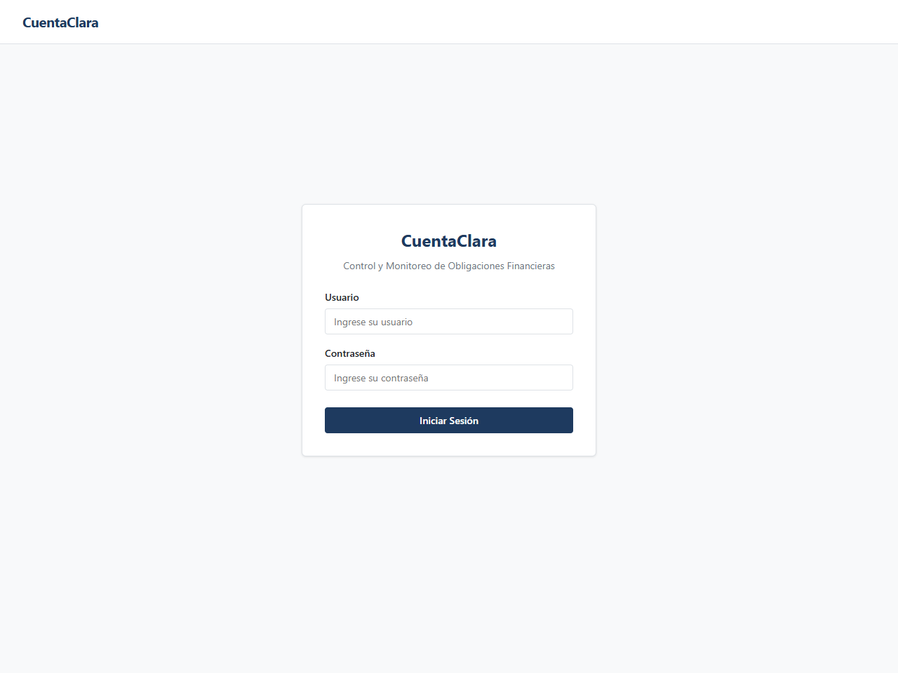
- **Resultado:** *Cumplido (Criterio 1.1).*

---

### Paso 2: Control de Seguridad y Manejo de Erres (HU-01, Criterio 1.2)
- **Historia:** HU-01: Autenticación y Control de Acceso por Rol
- **Descripción:** Al ingresar credenciales inválidas, el sistema muestra el mensaje directo `"Usuario o contraseña incorrectos."`.
- **Captura:** 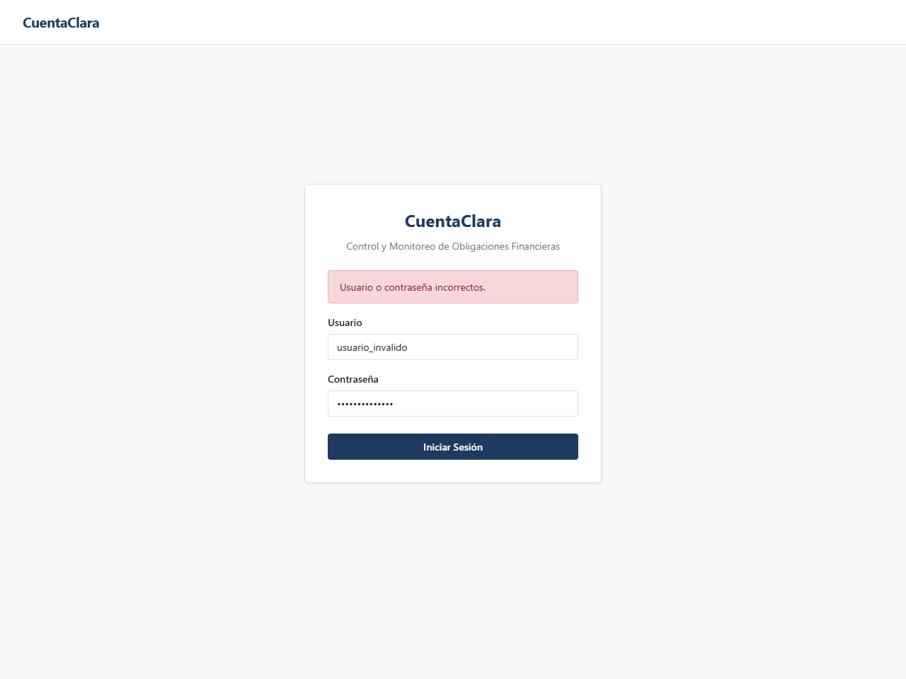
- **Resultado:** *Cumplido (Criterio 1.2).*

---

### Paso 3: Dashboard del Gerente con 4 KPIs y Pantalla Unificada (HU-01, HU-02, Criterios 1.3, 2.1, 2.2)
- **Historia:** HU-02: Dashboard Ejecutivo del Gerente y Navegación Temporal
- **Descripción:** Visualización de los 4 indicadores clave (Total Pendiente: S/ 6,370.35, Total Pagado: S/ 3,550.00, Deudas Vencidas Anteriores: S/ 195.00 y Próximo Vencimiento: 18/10/2026). Debajo, en la misma pantalla, se despliegan juntas las tablas de pendientes y realizados.
- **Captura:** 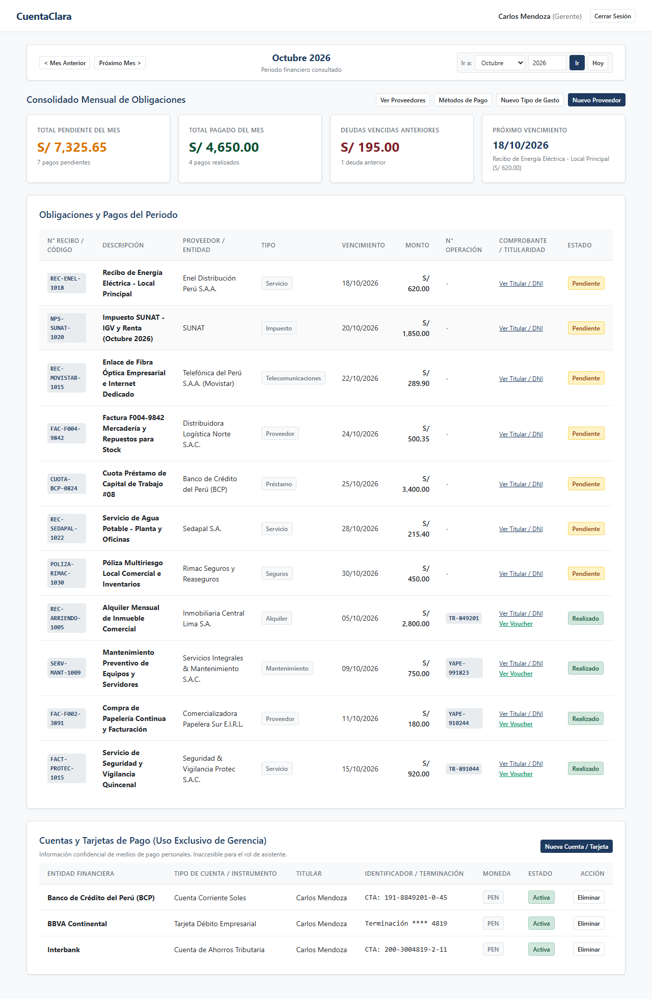
- **Resultado:** *Cumplido (Criterios 2.1 y 2.2).*

---

### Paso 4: Navegación Temporal: Mes Anterior - Septiembre 2026 (HU-02, Criterio 2.3)
- **Historia:** HU-02: Dashboard Ejecutivo del Gerente y Navegación Temporal
- **Descripción:** Al pulsar `< Mes Anterior`, se consulta Septiembre 2026, evidenciando el recibo de Sedapal N° `REC-SEDAPAL-0922` (S/ 195.00) que quedó impago y genera la alerta de deuda vencida anterior.
- **Captura:** 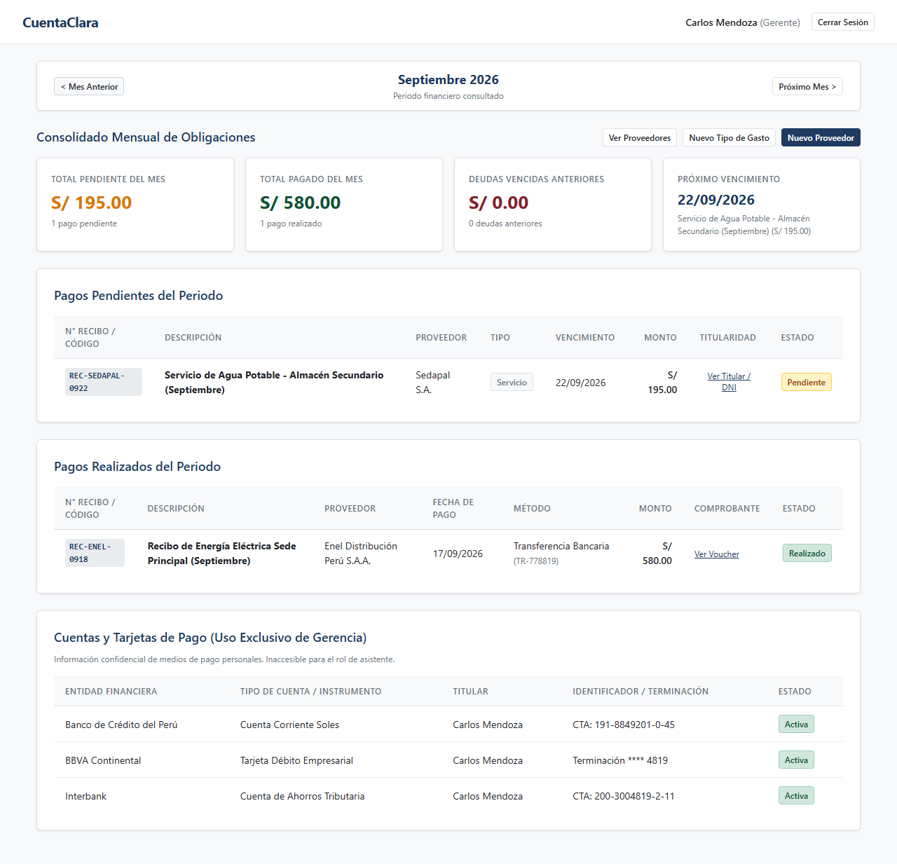
- **Resultado:** *Cumplido (Criterio 2.3).*

---

### Paso 5: Navegación Temporal: Próximo Mes - Noviembre 2026 (HU-02, Criterio 2.3)
- **Historia:** HU-02: Dashboard Ejecutivo del Gerente y Navegación Temporal
- **Descripción:** Al pulsar `Próximo Mes >`, el Gerente audita las obligaciones proyectadas de Noviembre 2026 (S/ 5,320.00 en SUNAT y cuota bancaria BCP).
- **Captura:** 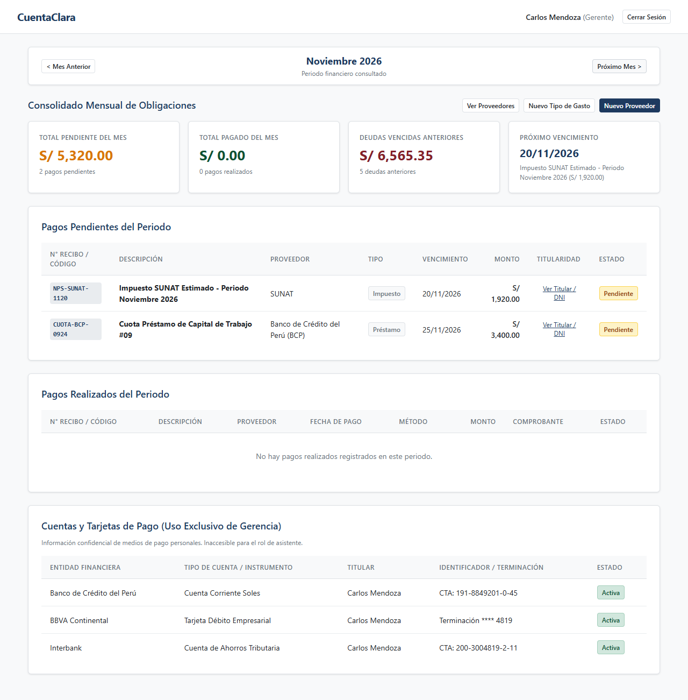
- **Resultado:** *Cumplido (Criterio 2.3).*

---

### Paso 6: Comprobación de Titularidad y Deuda Propia con Foto DNI (HU-03, Criterio 3.2)
- **Historia:** HU-03: Identificación del Recibo y Comprobación de Titularidad
- **Descripción:** Cada fila cuenta con el botón `Ver Titular / DNI`, el cual abre la ventana modal con la foto del DNI y acreditación del titular del negocio.
- **Captura:** 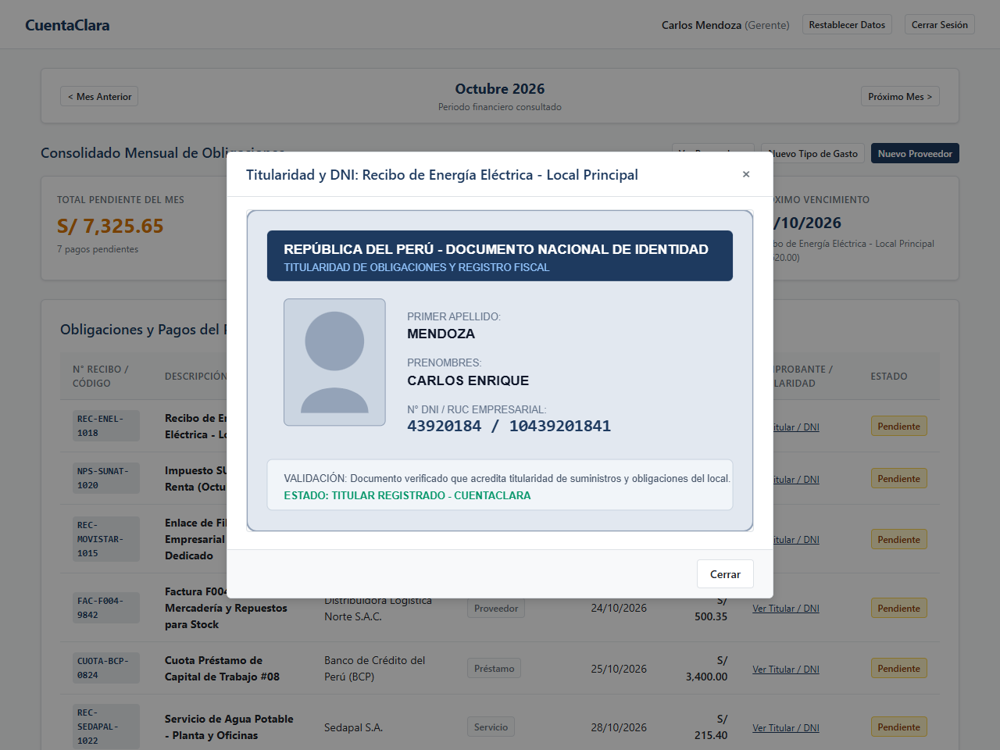
- **Resultado:** *Cumplido (Criterio 3.2).*

---

### Paso 7: Privacidad de Cuentas Financieras del Gerente (HU-02, Criterio 2.4)
- **Historia:** HU-02: Dashboard Ejecutivo del Gerente y Navegación Temporal
- **Descripción:** Sección confidencial de cuentas bancarias y tarjetas empresariales visible únicamente en la sesión de gerencia.
- **Captura:** 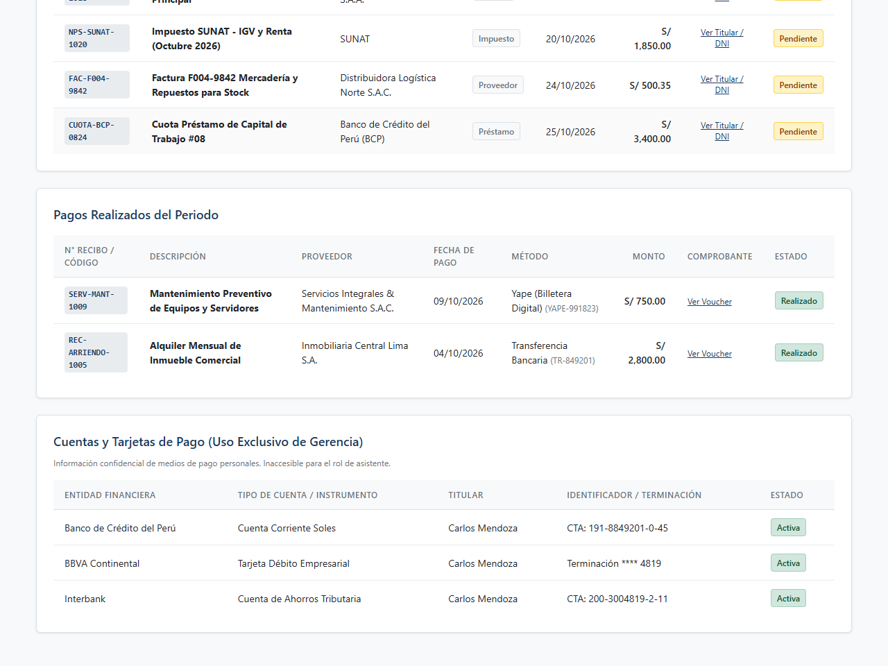
- **Resultado:** *Cumplido (Criterio 2.4).*

---

### Paso 8: Gobierno por Gerencia: Proveedor con Billetera Digital Yape (HU-04, Criterio 4.1)
- **Historia:** HU-04: Gobierno de Proveedores y Tipos de Gasto por Gerencia
- **Descripción:** Formulario donde el Gerente registra proveedores indicando número de celular y titular/alias de Yape.
- **Captura:** 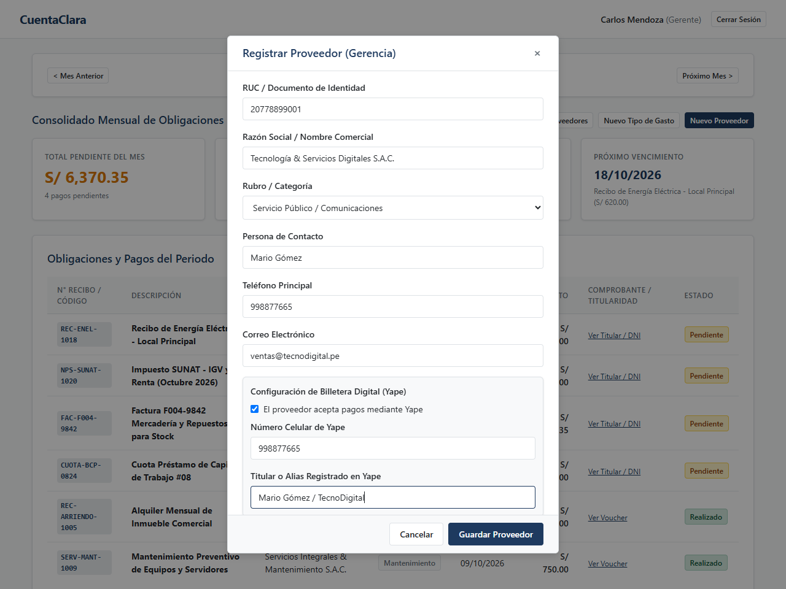
- **Resultado:** *Cumplido (Criterio 4.1).*

---

### Paso 9: Creación de Nuevos Tipos de Gasto por Gerencia (HU-04, Criterio 4.2)
- **Historia:** HU-04: Gobierno de Proveedores y Tipos de Gasto por Gerencia
- **Descripción:** Modal para que el Gerente cree nuevas categorías personalizadas (ej. `Seguros Empresariales`).
- **Captura:** 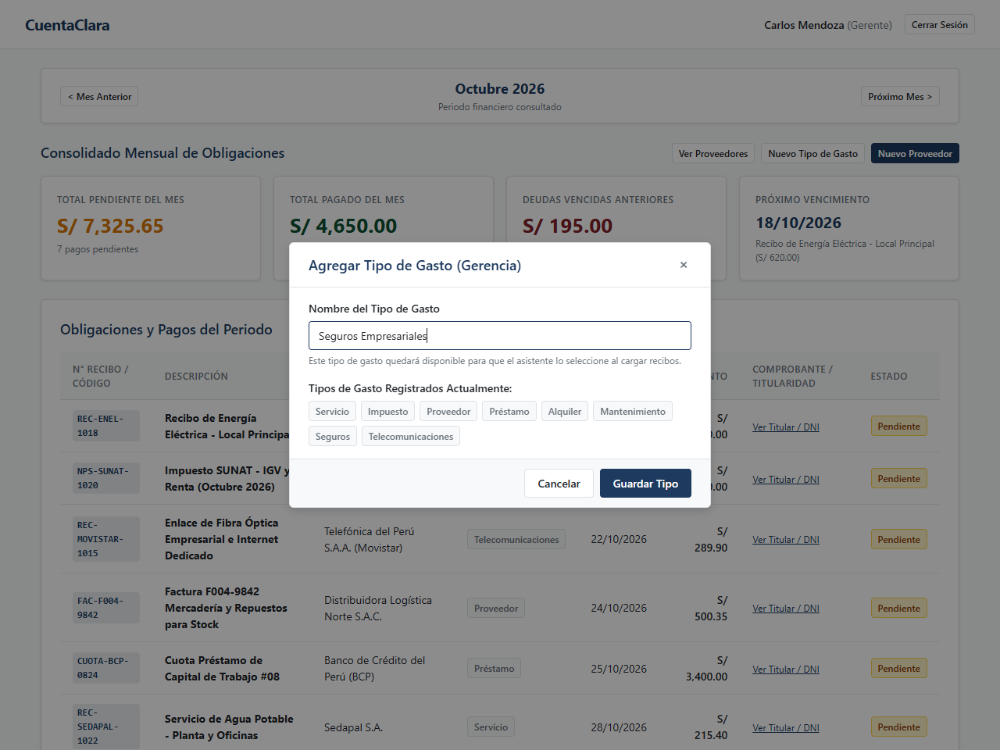
- **Resultado:** *Cumplido (Criterio 4.2).*

---

### Paso 10: Catálogo Consolidado de Proveedores (HU-04, Criterio 4.3)
- **Historia:** HU-04: Gobierno de Proveedores y Tipos de Gasto por Gerencia
- **Descripción:** Consulta del directorio autorizado de acreedores y sus datos de contacto y Yape.
- **Captura:** 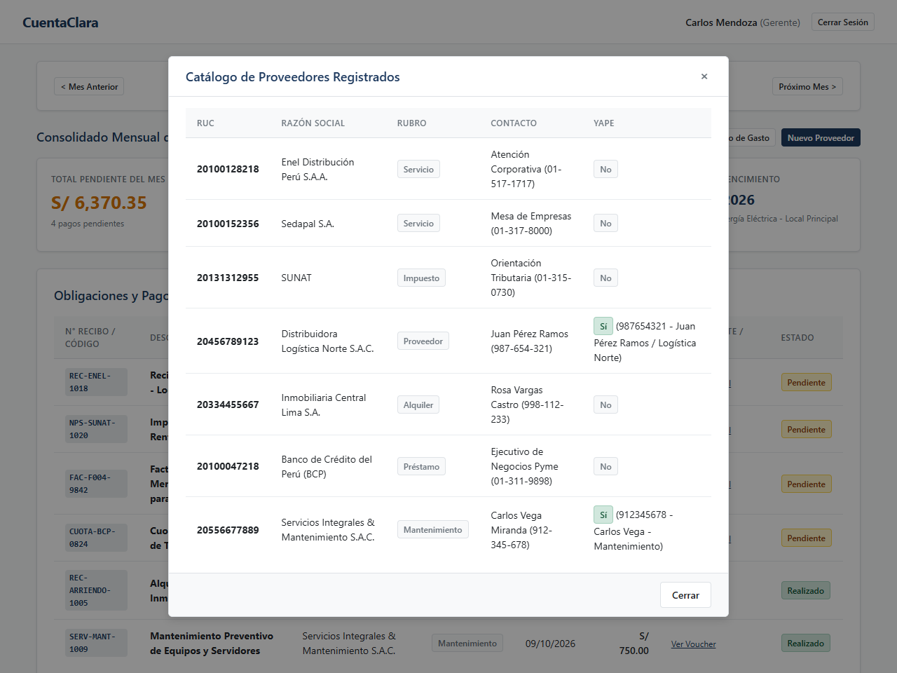
- **Resultado:** *Cumplido (Criterio 4.3).*

---

### Paso 11: Consola Operativa del Asistente (HU-01, Criterio 1.4)
- **Historia:** HU-01: Autenticación y Control de Acceso por Rol
- **Descripción:** Vista operativa del asistente con filtros por proveedor, tipo, estado y orden de vencimiento.
- **Captura:** 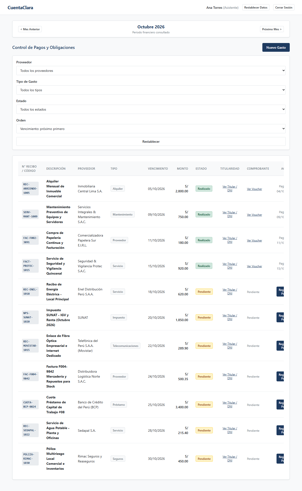
- **Resultado:** *Cumplido (Criterio 1.4).*

---

### Paso 12: Registro de Nuevo Gasto con Identificador Oficial de Recibo (HU-03, HU-04)
- **Historia:** HU-03 / HU-04: Gestión Operativa de Obligaciones
- **Descripción:** Formulario para registrar un gasto con su código de recibo oficial, consumiendo únicamente proveedores y tipos aprobados por Gerencia.
- **Captura:** 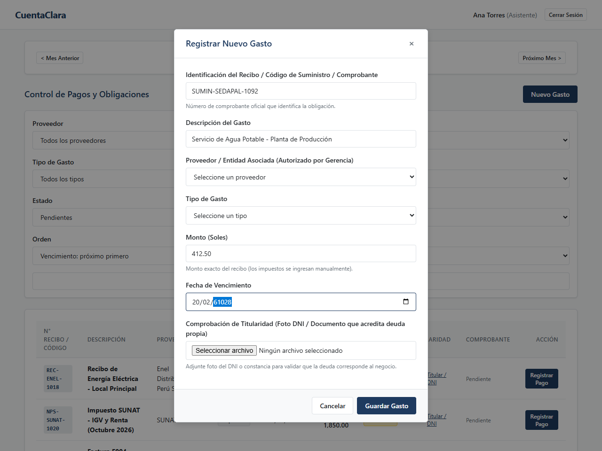
- **Resultado:** *Cumplido (Criterios 3.1 y 4.3).*

---

### Paso 13: Liquidación con Yape: Visualización Automática de Datos (HU-05, Criterio 5.1)
- **Historia:** HU-05: Liquidación de Pagos con Yape, Efectivo y Evidencia Fotográfica
- **Descripción:** Al elegir Yape, el sistema muestra automáticamente el celular `987654321` y titular `Juan Pérez Ramos / Logística Norte` registrados por Gerencia.
- **Captura:** 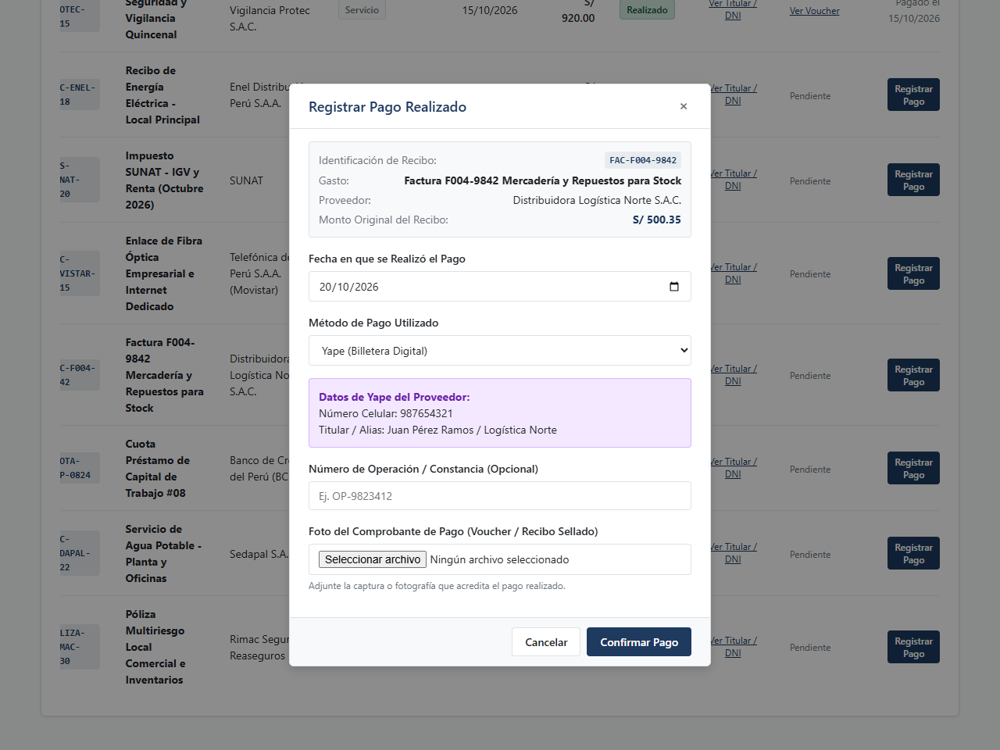
- **Resultado:** *Cumplido (Criterio 5.1).*

---

### Paso 14: Liquidación en Efectivo: Redondeo Ley N° 29571 / BCRP (HU-05, Criterio 5.2)
- **Historia:** HU-05: Liquidación de Pagos con Yape, Efectivo y Evidencia Fotográfica
- **Descripción:** Demostración exacta para recibos con céntimos (Factura por S/ 500.35). El sistema aplica el redondeo obligatorio hacia abajo a S/ 500.30 (-S/ 0.05). Con S/ 510.00 recibidos, calcula reactivamente el `Vuelto a Recibir: S/ 9.70`.
- **Captura:** 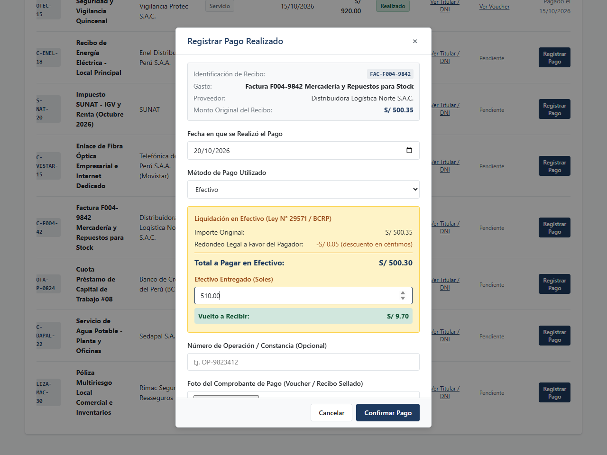
- **Resultado:** *Cumplido (Criterio 5.2).*

---

### Paso 15: Actualización Inmediata a Estado 'Realizado' (HU-05, Criterio 5.3)
- **Historia:** HU-05: Liquidación de Pagos con Yape, Efectivo y Evidencia Fotográfica
- **Descripción:** Al confirmar el pago, la obligación cambia a estado `Realizado` y se sincroniza en el balance mensual.
- **Captura:** 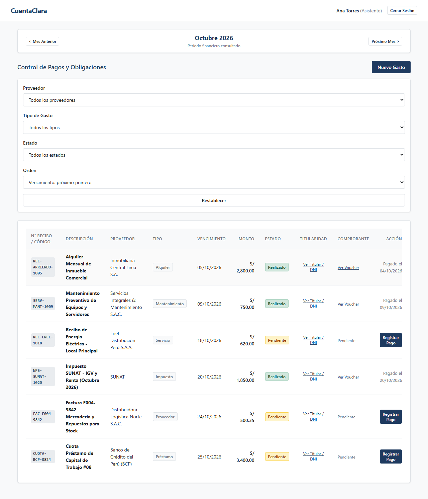
- **Resultado:** *Cumplido (Criterio 5.3).*

---

### Paso 16: Evidencia Documental: Foto del Comprobante / Voucher (HU-05, Criterio 5.3)
- **Historia:** HU-05: Liquidación de Pagos con Yape, Efectivo y Evidencia Fotográfica
- **Descripción:** Modal que previsualiza a tamaño completo la captura del voucher bancario archivado mediante el botón `Ver Voucher`.
- **Captura:** 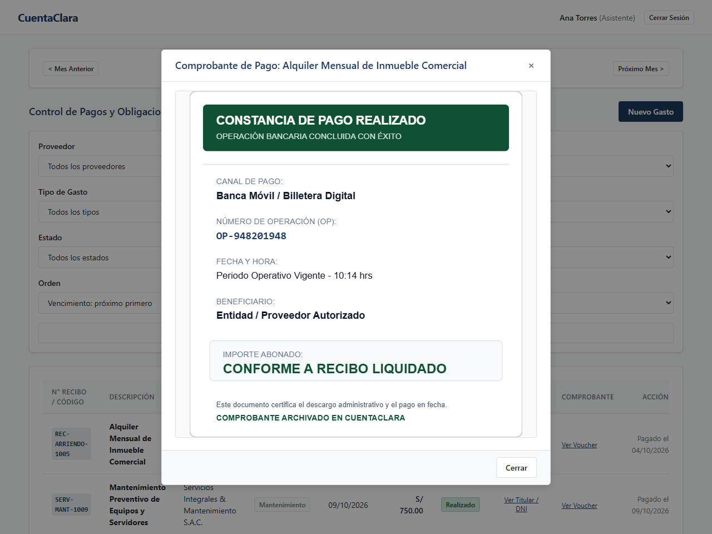
- **Resultado:** *Cumplido (Criterio 5.3).*

---

## 7. Matriz de Verificación de Restricciones de Diseño

| Restricción Evaluada | Estado | Verificación Técnica Realizada |
| :--- | :---: | :--- |
| **Cero Emojis en la UI** | Cumplido | Verificación exhaustiva: 0 emojis en todo el código HTML, CSS, JavaScript y textos informativos. |
| **Sin viñetas con líneas verticales** | Cumplido | No se emplearon listas con barras verticales estilo IA; diseño basado en tablas limpias. |
| **Identidad corporativa sobria** | Cumplido | Nombre limpio (**CuentaClara**), sin referencias académicas, cursos ni universidades en UI. |
| **Textos directos y funcionales** | Cumplido | Sin saludos artificiales de IA ('Bienvenido...'). Textos directos ('Usuario o contraseña incorrectos.'). |
| **Paleta de 3 colores corporativos** | Cumplido | Azul oscuro corporativo (`#1E3A5F`), fondo gris (`#F8F9FA`) y acento ámbar/naranja (`#D97706`). |
| **Retícula de espaciado en 8px** | Cumplido | Sistema ordenado en variables CSS en múltiplos de 8px (8, 16, 24, 32). |
| **Bordes y sombras sutiles** | Cumplido | Radio de bordes de 4px a 6px; sombras suaves `0 1px 3px rgba(0,0,0,0.1)`. |
| **Navegación minimalista** | Cumplido | Pantalla única para el Gerente con vista conjunta de listas y selector de meses central. |
| **Privacidad de medios de pago** | Cumplido | Cuentas bancarias personales visibles únicamente en la sesión de gerencia. |
| **Cumplimiento legal Ley 29571** | Cumplido | Algoritmo de redondeo hacia abajo a favor del cliente con cálculo de vuelto en efectivo. |
